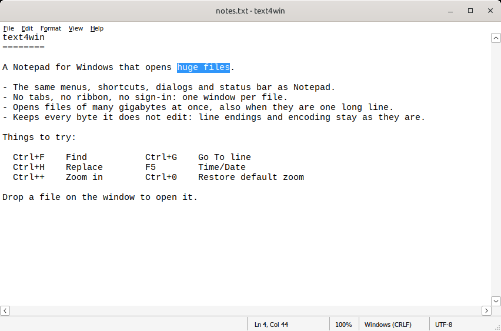

# text4win

A Notepad for Windows that opens huge files, written in Go with
[Windigo](https://github.com/rodrigocfd/windigo). It looks and works like the
Notepad of Windows 10: the same menus, shortcuts, dialogs and status bar, one
window per file and no tabs. The difference is under the hood. Notepad loads a
file into a Windows edit control and gives up on large ones; text4win draws the
text itself and leaves the file where it is, so a log of many gigabytes opens
in seconds and scrolls, searches and edits like a small one.

## Features

- The Notepad menus: File (New, New Window, Open, Save, Save As, Page Setup,
  Print), Edit (Undo, Cut, Copy, Paste, Delete, Find, Find Next, Find Previous,
  Replace, Go To, Select All, Time/Date), Format (Word Wrap, Font), View (Zoom,
  Status Bar) and Help.
- Title bar with the file name and a star for unsaved changes, and the "Do you
  want to save changes" question with Save, Don't Save and Cancel.
- Status bar with line and column, zoom, line ending and encoding.
- Find and Replace with "Match case" and "Wrap around", in a dialog that stays
  open while you edit. Go To Line works with word wrap on too.
- Encodings ANSI, UTF-16 LE, UTF-16 BE, UTF-8 and UTF-8 with BOM, detected on
  open and chosen in the Save As dialog. New files are UTF-8.
- Windows (CRLF), Unix (LF) and Macintosh (CR) line endings. A file keeps the
  ones it has, Enter adds the kind the file starts with and pasted text is
  converted to it.
- Drop a file on the window to open it.
- Word wrap, any font, zoom from 10% to 500% (also with Ctrl and the mouse
  wheel).
- Page Setup with margins, header and footer (the Notepad codes `&f`, `&p`,
  `&d`, `&t`, `&l`, `&c`, `&r` and `&&`) and printing in the font of the window.
- The `.LOG` trick: a file that starts with `.LOG` gets the time and date added
  each time it is opened.
- `text4win file` opens a file, `text4win /p file` prints it.
- Follows the light and dark app mode of Windows.
- Checks for a newer release on request (Help, Check for Updates) and installs
  it. Nothing is checked automatically.

Where it differs from Notepad on purpose: undo has many levels (Ctrl+Y or
Ctrl+Shift+Z is redo), a selected line break is shown, the menu bar has the
colour of the status bar instead of white, and the Search with Bing and Send
Feedback menu items are gone.

## Huge files

- Files up to 256 MB are read into memory, like Notepad does. Larger files are
  memory mapped: only the parts you look at are read, and no memory is used
  for the rest.
- The text is kept as a piece table. An edit never moves the rest of the file,
  so typing at the start of a 10 GB file is as fast as in an empty one.
- A sparse index of the line breaks is built when the file opens, on all CPU
  cores, with the progress in the status bar. After that, going to any line
  and counting lines are instant. Closing the window cancels the opening.
- Nothing is done per line or per row of the whole file. The vertical
  scrollbar works in bytes, and lines longer than 8192 bytes are laid out in
  parts, so a file that is one line of a gigabyte also works, with and without
  word wrap. Without word wrap such a line continues on the next row after
  8192 bytes (in Notepad that happened after 1024 characters).
- Bytes that are not edited are written back as they were: mixed line endings
  and invalid UTF-8 survive a save.

Limits to know about:

- A memory mapped file stays open while you look at it. Other programs can
  read and append to it, but not delete or shrink it.
- Saving a memory mapped file writes a new file next to it and swaps the two,
  so it needs free space for a second copy, and the undo list is empty after
  the save. Smaller files are written in place and keep their undo list.
- Only UTF-8 (and plain ASCII) is used straight from the file. UTF-16 and ANSI
  files are converted in memory when they open, so they need memory for their
  size. For files of 256 MB and more the encoding is detected from the first
  megabyte.
- At most 1 GB of text goes to the clipboard at once.

## Keyboard

| Key                         | Action                         |
| --------------------------- | ------------------------------ |
| Ctrl+N, Ctrl+Shift+N        | New, New Window                |
| Ctrl+O, Ctrl+S, Ctrl+Shift+S | Open, Save, Save As            |
| Ctrl+P                      | Print                          |
| Ctrl+Z, Ctrl+Y              | Undo, Redo                     |
| Ctrl+X, Ctrl+C, Ctrl+V, Del | Cut, Copy, Paste, Delete       |
| Ctrl+F, F3, Shift+F3        | Find, Find Next, Find Previous |
| Ctrl+H                      | Replace                        |
| Ctrl+G                      | Go To line                     |
| Ctrl+A, F5                  | Select All, Time/Date          |
| Ctrl+Plus, Ctrl+Minus, Ctrl+0 | Zoom in, zoom out, 100%      |
| Ctrl+Backspace              | Delete the word before the caret |
| Ctrl+W                      | Close the window               |

## Install

Download `text4win-<version>-amd64.msi` from the
[releases](https://github.com/mevdschee/text4win/releases) and run it. It
installs `text4win.exe` in `%LOCALAPPDATA%\Programs\text4win` and adds a
"text4win" shortcut to the Start menu. It installs for the current user only,
so it does not need admin rights. Newer versions replace older ones. The
installer is not signed, so Windows SmartScreen may ask you to confirm ("More
info", "Run anyway").

After the install text4win is in the "Open with" list of Explorer and
`text4win` works in the Run box. It does not take over `.txt` files: choose
"Open with", "Choose another app" and "Always" if you want that.

It runs on 64-bit Windows 10 and 11.

## Data

Settings (font, word wrap, status bar, window position and page setup) are in
`%APPDATA%\text4win\settings.json`. The only network access is the update check
you start yourself.

## Build (on Linux)

Install the tools once:

    sudo apt install jq wixl msitools wine
    go install github.com/tc-hib/go-winres@latest

The icon, manifest (visual styles, DPI awareness) and version info are compiled
from `winres/` into `cmd/text4win/rsrc_windows_amd64.syso`, which is not
committed. `run.sh` and `release.sh` generate it.

    go test ./...
    ./run.sh [file]

`run.sh` builds `text4win.exe` and runs it with Wine. Wine has its own
`%APPDATA%`, so the settings there are kept apart from a real install.
`TEXT4WIN_THEME=dark ./run.sh` shows the dark colours. Wine draws the menu bar
itself, always white, and has no dark menus and scrollbars.

The icon is `winres/icon.svg`. After changing it, run `go run ./tools/genicon`
(needs Inkscape) to render the PNG files next to it.

## Release

    ./release.sh          # 0.1.0 -> 0.1.1 (build, the default)
    ./release.sh minor    # 0.1.1 -> 0.2.0
    ./release.sh major    # 0.2.0 -> 1.0.0
    ./release.sh msi      # only build the MSI of the current version

`release.sh` needs a clean working tree. It raises the version in
`winres/winres.json` (`file_version`, as `major.minor.build.revision`; the
revision goes up on every release), runs the tests, builds
`dist/text4win-<version>-amd64.msi`, commits and pushes the version bump and
creates the GitHub release with the MSI. Besides the build tools above it
needs the GitHub CLI (`gh`). The installer is defined in
`installer/text4win.wxs`.

## Layout

- `internal/doc`: the document. Piece table, line index, search, encodings,
  memory mapping. No user interface, tested on any platform.
- `internal/ui`: the window. `editor.go` is the text area, `app.go` the menus
  and commands, `find.go` the Find, Replace and Go To dialogs, `print.go`
  printing, `theme.go` light and dark.
- `internal/config`, `internal/update`: settings and the update check.
